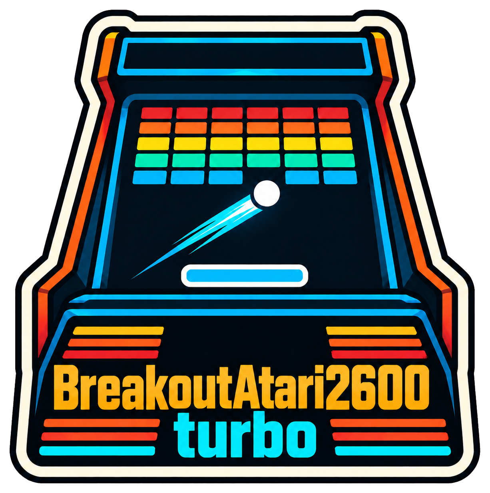
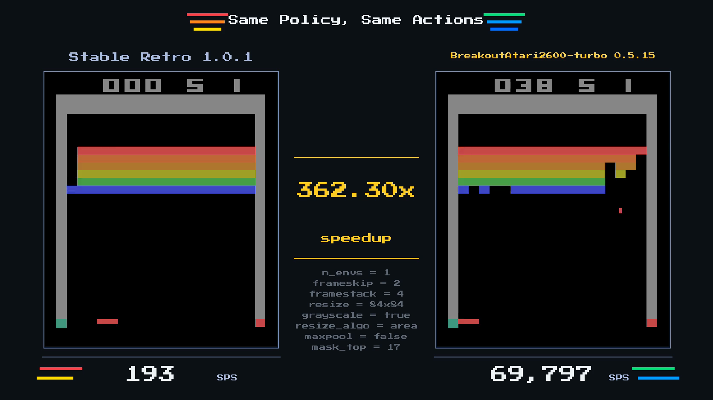
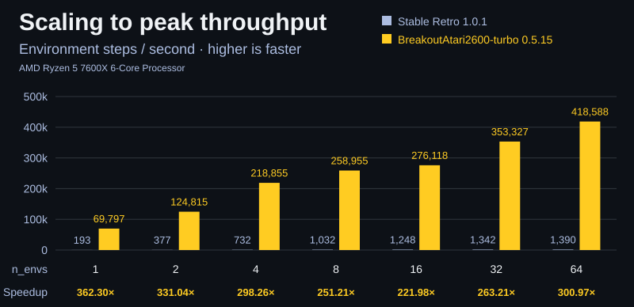
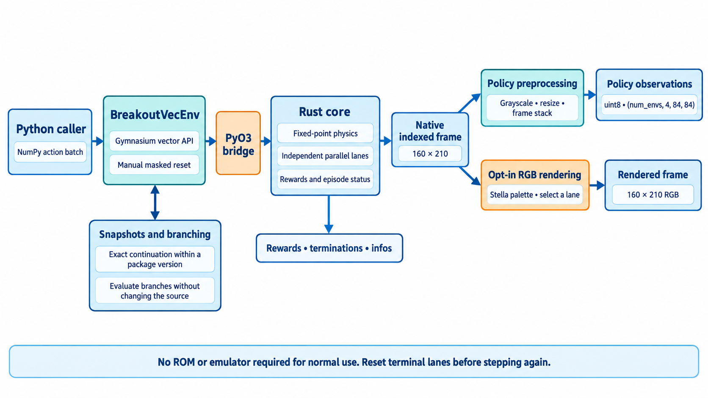

<p align="center">
  
  <br />
  <!-- repo-tagline:start -->
  <strong>🕹️ Reproducible Breakout for parallel RL experiments ⚡</strong>
  <!-- repo-tagline:end -->
</p>

<p align="center">
  <a href="https://github.com/tsilva/env-BreakoutAtari2600-turbo-native/actions/workflows/ci.yml"></a>
  <a href="https://pypi.org/project/env-breakoutatari2600-turbo-native/"></a>
  <a href="https://github.com/tsilva/env-BreakoutAtari2600-turbo-native/blob/main/pyproject.toml"></a>
  <a href="https://github.com/tsilva/env-BreakoutAtari2600-turbo-native/blob/main/LICENSE"></a>
</p>

A native Atari 2600 Breakout environment with a Gymnasium interface for
parallel reinforcement learning. Use it to play Breakout locally or train
against a repeatable observation, action, and episode contract.

<p align="center">
  <a href="https://github.com/tsilva/env-BreakoutAtari2600-turbo-native/blob/showcase-v0.5.15-20261005-style5/demo.mp4">
    
  </a>
</p>

<p align="center">
  
</p>

[Benchmark results, method, and proof](https://github.com/tsilva/env-BreakoutAtari2600-turbo-native/blob/main/benchmarks.md).

## Quick start

Requires Python 3.11+ on Apple-silicon macOS 11+ or x86-64 Linux with glibc 2.28+.
Playing needs no ROM, emulator, or Rust installation.

With [uv](https://docs.astral.sh/uv/) installed, create a project and open the
interactive player:

```bash
uv init --python 3.11 breakout-experiment
cd breakout-experiment
uv add "env-breakoutatari2600-turbo-native[play]"
uv run env-breakoutatari2600-turbo-native play
```

Move with ←/→ or A/D, press Space to serve, and Escape to quit. Press P to
pause or R to restart. Add `--uncapped` to play without a display-rate limit,
or `--help` to see all player options.

For an existing project, skip `uv init` and `cd`. If you only need the Python
API, install without the optional player: `uv add env-breakoutatari2600-turbo-native`.

## Train an agent

See [training recipes and a Python example](https://github.com/tsilva/env-BreakoutAtari2600-turbo-native/blob/main/docs/training.md).
The environment reference covers reset behavior, game signals, and compatibility
with Stable Retro.

## Documentation and contributing

- [Environment reference](https://github.com/tsilva/env-BreakoutAtari2600-turbo-native/blob/main/docs/environment.md):
  actions, preprocessing, rendering, snapshots, branching, game signals,
  [Stable Retro Turbo] compatibility, and the optional Stable-Baselines3 adapter.
- [Performance comparison](https://github.com/tsilva/env-BreakoutAtari2600-turbo-native/blob/main/benchmarks.md)
  and [release validation](https://github.com/tsilva/env-BreakoutAtari2600-turbo-native/blob/main/docs/release-validation.md):
  timing methodology, parity evidence, validation limits, and evidence ownership.
- [Contributing](https://github.com/tsilva/env-BreakoutAtari2600-turbo-native/blob/main/CONTRIBUTING.md):
  source setup, development commands, and tests.
- [Support](https://github.com/tsilva/env-BreakoutAtari2600-turbo-native/blob/main/SUPPORT.md)
  and [changelog](https://github.com/tsilva/env-BreakoutAtari2600-turbo-native/releases):
  installation help, supported platforms, and changes during the `0.x` community preview.

## Architecture



## License

[MIT](https://github.com/tsilva/env-BreakoutAtari2600-turbo-native/blob/main/LICENSE).
See [third-party notices](https://github.com/tsilva/env-BreakoutAtari2600-turbo-native/blob/main/THIRD_PARTY_NOTICES.md)
for Atari, [Stable Retro], ROM, and trademark boundaries.

[Gymnasium]: https://gymnasium.farama.org/
[Stable Retro]: https://stable-retro.farama.org/
[Stable Retro Turbo]: https://github.com/tsilva/env-StableRetro-turbo

[MIT License](LICENSE).
